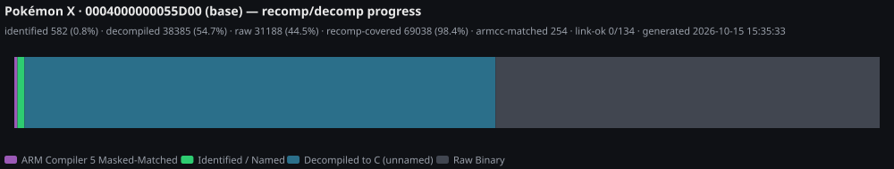
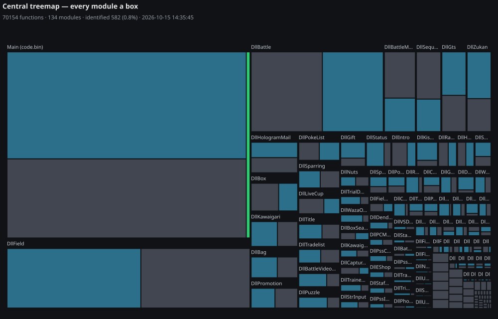

# PokeXYZ-RDComp

One project space for the Pokémon X/Y native **R**ecomp + **D**ecomp
effort — a Rust-first toolkit where [3dsrecomp](https://github.com/fearkov/3dsrecomp)
turns a decrypted dump into a native Linux binary, the `xy` CLI extracts and
converts every game format, a matching-decompilation loop
(3DS-Decomp-Pipeline + objdiff) rebuilds the original code byte-for-byte,
and a zakuro-based runtime track carries the HLE runtime layer. Python
shows up only as helper scripts under `xy-heatmap/` (heatmap, rebuild glue).

## Layout

| Path | What it is |
|---|---|
| `xy-extraction/` + `src/` | the extraction toolkit — 8 domain crates (`xy-core/archive/audio/gfx/script/battle/curate/convert`) behind the unified `xy` CLI: unpack → curate → convert |
| `xy-recomp/` | static-recomp track: `build.sh` port builder, C override shims |
| `xy-decomp/` | matching-decomp track: patched 3DS Ghidra suite + PyGhidra driver + symbol exporter |
| `xy-runtime/` | runtime track: zakuro-based native runtime (working clone gitignored) |
| `xy-heatmap/` | progress-heatmap toolkit: live tabbed dashboard + `readme` asset generator (`xhmap/` Python package) |
| `xy-viz/` | charming (ECharts) renderer that turns `heatmap_data.json` into the committed README assets below |
| `.thirdparty/` | upstream checkouts (3dsrecomp, zakuro, 3DS-Decomp-Pipeline, objdiff) + `reference/` clones — machine-local; `fetch.sh` recreates the four |
| `docs/` | the research log (map in its `README.md`): `general/findings.md` (recomp metrics, gotchas, round-trip results), `decomp/ghidra-scripts.md`, `runtime/runtime-architecture.md`, per-topic folders |
| `.Data/` | **your** game-derived material — dumps, extracts, generated code, ports. Machine-local by convention; never commit or share |

**Convention:** dot-prefixed top-level dirs (`.Data/`, `.thirdparty/`) are
machine-local workspace material — never committed except their
README/index files; non-dot dirs are repo content; game tracks are
`xy-`-prefixed.

## Quick start

```bash
# toolkit
cargo build --release
./target/release/xy gfx icon .Data/Raw_Extracted/exefs/icon.bin -o icon.png

# native standalone port (needs Rust, gcc/clang, ar; your own decrypted dump)
./.thirdparty/fetch.sh         # once — clones 3dsrecomp + zakuro
./xy-recomp/build.sh --run     # picks up .Data/Rom/X/Base/0004000000055D00_v00.3ds by default
```

## Status





The treemap: one box per CRO module (area ∝ function count), subdivided
into status tiers — dark grey **raw** → teal **decompiled to C** → green
**identified/named** → gold **natively verified**. Regenerate both with
`python3 xy-heatmap/heatmap.py readme`; the interactive tabbed dashboard
(Overview / Modules / Namespaces) lives at
`python3 xy-heatmap/heatmap.py serve --watch`.

- **X v1.0 recomp**: 71,163/74,340 functions reached (95.7%), 0 verify
  mismatches; standalone binary runs natively on Linux (X and Y).
- **Matching decomp**: 134/134 modules recreated **byte-identical** from
  generated splits (parity gate for future hand-written C).
- **Toolkit**: 65/65 golden tests byte/pixel-identical against upstream
  references; clippy `-D warnings` clean.
- **v1.5 update**: update partitions landed at `.Data/Rom/{X,Y}/Upd/`
  (v1.5 `code.bin` = 5,169,152 B) — see `.Data/README.md` before building
  against them.

Details and the full roadmap: [`AGENTS.md`](AGENTS.md),
[`PLAN.md`](PLAN.md), [`docs/general/findings.md`](docs/general/findings.md).

## Legal

Requires your own legally-obtained, **decrypted** game dumps. Everything
game-derived (dumps, extracted assets, generated C, symbol maps, port
projects, binaries) and all console key material is excluded from version
control by `.gitignore` and must never be shared or published. Upstream
tools are vendored unpackaged via `.thirdparty/fetch.sh` and keep their own
licenses (MIT for 3dsrecomp/zakuro/objdiff).
